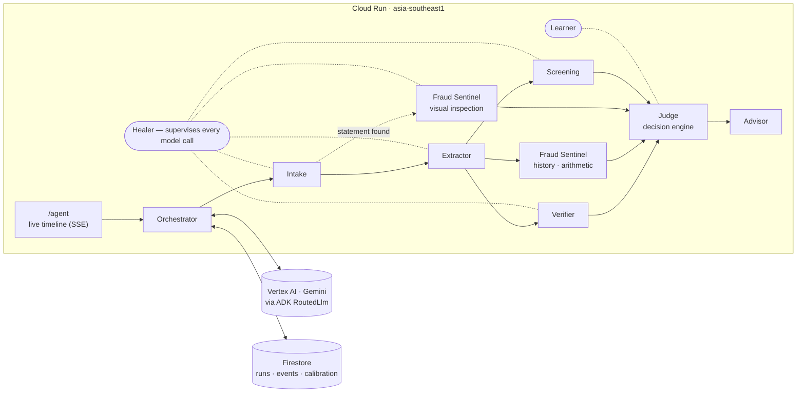

# Kredal — agentic bank-readiness on Gemini and Google Cloud

Small businesses are refused bank accounts for reasons nobody tells them: a
licence that names the company differently from the application, a passport
that expired last month, a bank statement that does not add up. Kredal reads a
company's documents before the bank does, finds what a compliance officer
would object to, and says exactly how to fix it.

This build runs that work as a **team of Gemini agents on Google's Agent
Development Kit**, deployed on **Cloud Run**. Every decision is a probability
with its evidence; the system acts only when it is sure enough for what is at
stake, asks a person when it is not, repairs its own failures, and learns from
every verified outcome how far to trust each model.

**Live demo:** https://kredal-168827050380.asia-southeast1.run.app/agent
**What it has learned so far:** https://kredal-168827050380.asia-southeast1.run.app/agent/learning

> Kredal produces a readiness assessment, risk flags and an application pack.
> It does not guarantee an account, and it is not affiliated with, endorsed by
> or partnered with any bank.

---

## Try it

Open **/agent**, pick a company, press **Run the agent team**, and watch the
timeline. Every company and document is a generated specimen — fictional
people, authorities and a "SPECIMEN BANK" — and each is designed to show one
behaviour:

| Company | What happens |
|---|---|
| **Qamar Orchard Foodstuff Trading** | A clean, consistent file. Every check clears on its own; nothing is asked. |
| **Bluewater Cargo FZ-LLC** | The licence names a different company, the passport has expired, the statement is a personal account. Flags, fixes and a rejection-recovery plan. |
| **Marina Lantern Events** | Readiness 100/100 — and **Integrity: do not submit**. Its bank statement was edited: the arithmetic no longer adds up, the inflated figure is set in another typeface, and the PDF was re-saved by a different program. |
| **Golden Jute Trading** | The owner's name resembles an entry on a (fictional, demonstration) watchlist that records no date of birth. Gemini is unsure, the check is critical, so **a person is asked** — and the answer is learned. |

**Run with an injected failure** sends the first model call to a Gemini model
id that does not exist — a real failed request to Vertex AI — so the Healer's
failover can be watched live.

---

## How it works



### The agents

| Agent | Does | Built with |
|---|---|---|
| **Intake** | Classifies each file, judges legibility | ADK `LlmAgent` + zod `outputSchema` |
| **Extractor** | Every field with a confidence and the exact quote | `LlmAgent`; escalates to the strong tier when a critical field is unsure |
| **Verifier** | Do the documents agree with each other and the profile? | Deterministic name match first; Gemini only for real differences (transliteration, initials, trading vs legal name) |
| **Fraud Sentinel** | Has a document been altered? | PDF file history read from the raw bytes · statement arithmetic · Gemini 3.1 Pro visual inspection |
| **Screening** | Does an owner resemble a listed person? | Phonetic match; Gemini weighs date of birth and nationality |
| **Judge** | Act, or ask a person | The decision engine (below) — pure, deterministic, unit-tested |
| **Advisor** | Fix plan, recovery plan, bank application pack | Kredal's existing report templates |
| **Healer** | Detects failures and repairs them | ADK `RoutedLlm` + `ReflectAndRetryModelPlugin` + a supervisor |
| **Learner** | Learns how far to trust each model, per skill | Calibration curves in Firestore |

### The decision engine

Every decision is a typed judgment, never free text:

```ts
interface Judgment<V> {
  question: string;        // "Is the passport holder the listed owner?"
  verdict: V;              // typed: boolean | enum | number
  probability: number;     // calibrated — see the Learner
  evidence: EvidenceRef[]; // document, field, the exact quote
  ruleIds: string[];       // which published scoring rules it feeds
  severity: "info" | "standard" | "critical";
}
```

- **Rules decide the score.** Kredal's 32 published scoring rules are
  unchanged; models supply what the documents say, and the rules score it.
- **A bar per severity.** The engine acts alone only above 60% / 85% / 97% for
  info / standard / critical checks. Below the bar, a person gets one precise
  question — the system never silently guesses either way.
- **A rule and a model that disagree go to a person.** Neither side wins by
  default.
- **The score is a range while anything is pending** ("58–71, most likely 66")
  and collapses to one number as questions are answered.
- **Integrity is a gate, not a deduction.** An altered statement does not make
  a file weaker; it makes it unsubmittable, whatever the score.

### Self-healing

| Failure | Repair |
|---|---|
| Model returns an error (404, 429, 5xx) | `RoutedLlm` fails over down a chain: `gemini-3.8-flash` → `gemini-3.5-flash` → `gemini-2.5-pro` |
| Model never answers | Every call has a deadline (`TimedLlm`); silence becomes an ordinary failure and fails over |
| Output fails its schema | Re-asked with the validation error attached |
| A critical field is unsure | Escalated to the strong tier (`gemini-3.1-pro-preview`), told which fields to re-read |
| Malformed model turn | ADK's `ReflectAndRetryModelPlugin` |
| Still unresolved | A person is asked — never a guess |

Every detection and repair is an event on the timeline and in Firestore.

### Self-learning

A model that says it is 99% sure is not right 99% of the time. Every verified
outcome — a person answering a question, or a specimen's ground truth — is
recorded against the confidence the model claimed, per model and per skill
(reading a field, matching names, screening, spotting edits). The engine then
routes on the calibrated probability, so the same model output can be acted on
or sent to a person depending on what that model has earned. No model is
retrained; what changes is how far each one is believed.

Calibration is monotone (pool-adjacent-violators), stays close to the raw value
when evidence is thin, and never displays certainty the record does not
support. Field accuracy is **measured against ground truth**, not
self-reported — live figures at `/agent/learning`.

---

## Google Cloud

| | |
|---|---|
| **Compute** | Cloud Run, `asia-southeast1`, built by Cloud Build from the `Dockerfile` (Next.js standalone, non-root) |
| **Models** | Gemini on Vertex AI (global endpoint) through ADK; thinking set per model family — low for routine reads, full for escalations |
| **Auth** | Application Default Credentials. **There is no API key anywhere in this system.** |
| **Data** | Firestore, named database `kredal` — runs, timelines, reviews, calibration |
| **Identity** | A dedicated service account with least privilege: Vertex AI user; Firestore access restricted *by IAM condition* to the `kredal` database only; log and trace writer |

Deploy:

```bash
gcloud run deploy kredal --source . --region asia-southeast1 \
  --service-account kredal-run@PROJECT.iam.gserviceaccount.com --allow-unauthenticated \
  --set-env-vars GOOGLE_CLOUD_PROJECT=PROJECT,GOOGLE_CLOUD_LOCATION=global,KREDAL_FIRESTORE_DB=kredal
```

`.gcloudignore` governs what is uploaded (`.dockerignore` does not); no `.env`
file ever leaves the machine.

---

## Run it locally

```bash
npm install
gcloud auth application-default login     # Vertex AI + Firestore via ADC
cp .env.example .env.development.local    # set GOOGLE_CLOUD_PROJECT
npm run dev
```

```bash
npm test                                   # unit tests, no model calls
KREDAL_VERTEX_TESTS=1 GOOGLE_CLOUD_PROJECT=your-project npx vitest run vertex   # live agent tests
node scripts/specimens/generate.mjs       # regenerate the specimen documents
```

## Where things are

```
src/lib/agentic/
  decision/       the engine: judgments, calibration, policy, score ranges
  agents/         intake, extractor, verifier, fraud (+ screening), judge, advisor
  healer/         the supervisor and its repair strategies
  learning/       calibration curves in Firestore
  fraud/          PDF forensics, the demonstration watchlist
  jurisdictions/  country packs as data (UAE: Kredal's 32 published rules)
  models.ts       tiers, failover chains, deadlines, thinking per model
  run.ts          the orchestrator
src/app/agent/    the demo, run replays, the Learning page
scripts/specimens the generator for fictional, watermarked specimen documents
```

## Honest limits

- The specimen documents are generated and fictional; the watchlist is a
  demonstration list of fictional entries, **not** a sanctions or PEP screen.
  A production deployment screens against official consolidated lists.
- Calibration is only as good as the outcomes it has seen; with few answers it
  stays close to what the model claims, by design.
- The UAE pack is complete; other countries are the same engine with a
  different rules pack, not yet written.
